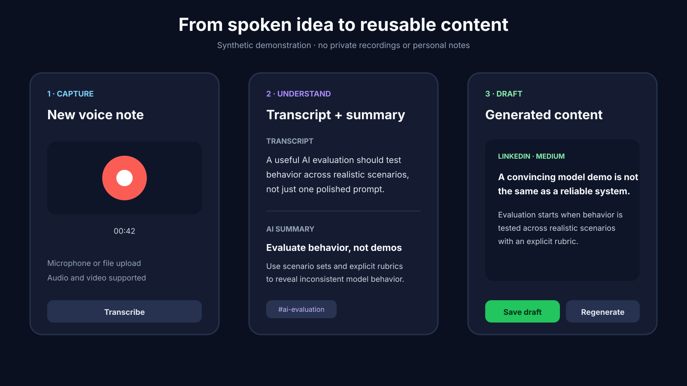
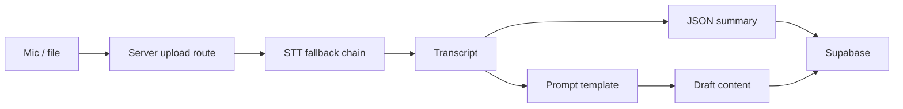

# VoiceNotes

**Voice-to-content workspace with transcription, summarization, and AI-assisted drafting.**

VoiceNotes turns microphone recordings or uploaded media into searchable notes, concise summaries, and draft social content. The app covers the whole flow: ingestion, model routing, persistence, access control, and reusable prompt templates.



## Why it exists

Ideas often arrive faster than they can be typed or organized. A useful voice workflow needs more than transcription: it must survive model failures, preserve the source, create structured derivatives, and keep provider credentials away from the client.

VoiceNotes treats the recording, transcript, summary, and generated posts as related artifacts rather than a single disposable model response.

## What it does

- records from the microphone or accepts audio/video uploads;
- transcribes through a configurable OpenRouter model and transport fallback chain;
- retries upstream 5xx responses with bounded backoff;
- derives a heading and summary as structured JSON;
- saves notes, style profiles, tags, and multiple generated posts in Supabase;
- generates short, medium, or long social drafts from editable prompt templates;
- supports search, related-note retrieval, export, and cached note lists;
- protects the application and API routes with revocable access sessions.

## How it works



The browser sends media to a Next.js route; it never receives provider credentials. The transcription adapter can try multiple models and both JSON and multipart transports, retrying bounded server failures and recording per-attempt diagnostics only when debug mode is explicitly enabled.

The summary route requests a JSON object and normalizes it into a heading and summary. Draft generation combines the transcript with a selected style snapshot, length policy, and optional instructions. Supabase stores the source note and its derived posts.

## A few implementation notes

- **Fallback matrix:** transcription can advance across configured models and request transports, not just repeat one failing call.
- **Bounded retries:** only upstream server failures are retried, with configurable backoff and input-size limits.
- **Server-side secrets:** OpenRouter and Supabase service credentials remain in route handlers.
- **Prompt templates:** summary and generation instructions are versionable Markdown files loaded independently of UI code.
- **Artifact lineage:** posts retain generation settings and a style snapshot alongside their source note.
- **Session management:** access cookies use signed tokens; active sessions can be listed and terminated.
- **Debug boundary:** detailed upstream attempts are returned only behind an explicit debug flag.
- **Test coverage:** Node tests cover access control, API error normalization, caching, export, tags, and template rendering; Playwright provides a smoke path.

## Tech stack

Next.js 16, React 19, JavaScript, OpenRouter, Supabase/PostgreSQL, Playwright, Node's built-in test runner.

## Running locally

```bash
npm ci
cp .env.example .env.local
npm run dev
```

Required and optional variables, including the transcription fallback chain, are documented in `.env.example`.

## Checks

```bash
npm test
npm run build
npm run test:smoke
```

The smoke test requires a configured local environment. Unit tests do not call live model providers.

## Current state

**Working prototype with an access-controlled deployment.** The deployed workspace is intentionally not a public demo. The visual above uses synthetic content and contains no private recordings.

## License

No open-source license has been declared.
